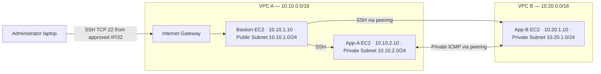

# AWS VPC Peering — Private Connectivity Lab

A documented AWS networking project built manually using the **AWS Management Console** and represented here as **Terraform infrastructure-as-code** for reproducibility.

> **Important:** The Terraform in this repository was reconstructed from the lab documentation. It is **not** an automatically exported snapshot of the existing AWS resources and it has **not** been applied or imported against the running lab. Do not run `terraform apply` against an account that already hosts this project unless you intend to create a separate environment or have completed a proper import and reviewed the plan.

## Overview

The lab connects two non-overlapping AWS Virtual Private Clouds in one AWS account and in the `us-east-1` Region through a VPC peering connection. A bastion host in VPC A gives SSH access to private EC2 instances. Route tables and security groups enable controlled ICMP connectivity between the application EC2 instances without assigning them public IPv4 addresses.

### Architecture



> Diagram is logical, not a literal AWS network packet-flow map. Peering is the connection used by the corresponding route tables; there is no VPN gateway or NAT in this design.

## AWS resources

| Component | VPC A | VPC B |
|---|---|---|
| VPC CIDR | `10.10.0.0/16` | `10.20.0.0/16` |
| Public subnet | `10.10.1.0/24` | None |
| Private subnet | `10.10.2.0/24` | `10.20.1.0/24` |
| Internet gateway | Attached to VPC A | None |
| Application EC2 | `ewb-app-a`, `10.10.2.10` | `ewb-app-b`, `10.20.1.10` |
| Bastion EC2 | `ewb-bastion`, `10.10.1.10` | None |
| Peering | Requester | Accepter |

Three custom route tables:

- **A public:** local `10.10.0.0/16`, internet `0.0.0.0/0` to IGW, remote `10.20.0.0/16` to peering.
- **A private:** local `10.10.0.0/16`, remote `10.20.0.0/16` to peering.
- **B private:** local `10.20.0.0/16`, remote `10.10.0.0/16` to peering.

Three security groups:

- `ewb-sg-bastion`: SSH TCP 22 only from the operator's public `/32` CIDR.
- `ewb-sg-app-a`: SSH TCP 22 from bastion `10.10.1.10/32`; ICMPv4 echo request from App-B `10.20.1.10/32`.
- `ewb-sg-app-b`: SSH TCP 22 from bastion `10.10.1.10/32`; ICMPv4 echo request from App-A `10.10.2.10/32`.

All three SGs have default outbound allow-all (teaching-lab setting). Private subnets have no default route to the internet; allowing outbound in a security group alone does not provide internet connectivity. Security groups are stateful.

## Connectivity tests recorded in the manual project

| Test | Observed result |
|---|---|
| Windows → bastion via SSH | Successful |
| Bastion jump → App-A via SSH | Successful |
| Bastion jump → App-B via SSH | Successful |
| App-A → App-B ping | **4/4 replies, 0% packet loss** |
| App-B → App-A ping | User-confirmed (terminal screenshot pending) |
| Remove App-B ICMP rule, retest | **4 sent, 0 received, 100% loss** |
| Restore App-B rule | User-confirmed (screenshot pending) |

These results come from the prior manual implementation; **do not present them as tests of the Terraform files**. Screenshot evidence can be added to `docs/screenshots/` after redacting sensitive information.

## Repository structure

```text
aws-vpc-peering-project/
├── README.md
├── .gitignore
├── LICENSE
├── terraform/
│   ├── versions.tf
│   ├── variables.tf
│   ├── main.tf
│   ├── outputs.tf
│   └── terraform.tfvars.example
├── docs/
│   ├── aws-console-export.md
│   ├── manual-implementation.md
│   ├── ssh-and-tests.md
│   └── screenshots/README.md
└── .github/workflows/terraform-validate.yml
```

## Infrastructure as code (optional, separate environment)

Prerequisites: AWS access with appropriate permissions, Terraform, an existing EC2 SSH key pair **in us-east-1**, and an SSH source CIDR restricted to **your** public IPv4 address `/32`.

```powershell
cd terraform
Copy-Item terraform.tfvars.example terraform.tfvars
# Edit terraform.tfvars: your SSH /32 CIDR, key pair name, instance size and AZ
terraform init
terraform fmt -check
terraform validate
terraform plan
# Do NOT run apply before reading the warning below.
```

**Do not run `terraform apply` to “upload code” or to manage the original manually created lab.** It can create duplicate paid EC2 instances, public IPv4 allocations and overlapping named resources. Terraform state must be established safely before managing existing resources; importing *every* dependent resource and checking drift is a separate, deliberate procedure. Never blindly apply/destroy generated resources.

This example uses an AL2023 AWS Systems Manager public AMI parameter; the AMI chosen later may differ from the exact manual EC2 launch.

## How to export the real, manually created AWS configuration

See [AWS Console → CloudFormation IaC Generator](docs/aws-console-export.md). It can discover supported existing resources and generate CloudFormation YAML/JSON. Review it before committing; generator output may need cleanup and may not cover all resource types. Exporting a template **does not automatically put live resources under stack management**.

## What I learned

- How to design non-overlapping private address ranges and subnet isolation.
- How to attach a public subnet to an Internet Gateway without exposing private EC2 instances.
- How to create and accept a VPC peering connection and install routes in **both** directions.
- How to use a bastion host / SSH ProxyJump to reach private hosts.
- How a single security-group ICMP rule can intentionally block and then restore a specific flow.

## Security and costs

Never commit AWS credentials, `*.pem` private keys, Terraform state (`*.tfstate`), actual `terraform.tfvars`, SSH private keys, or unredacted screenshots with personal data. A public IP address from a past test should not be assumed current. Cloud resources may incur EC2, IPv4 and data transfer costs even when the repository is free. Remove unused lab resources when finished.

## Reference documentation

- [AWS VPC peering](https://docs.aws.amazon.com/vpc/latest/peering/what-is-vpc-peering.html)
- [AWS CloudFormation IaC Generator](https://docs.aws.amazon.com/AWSCloudFormation/latest/UserGuide/generate-IaC.html)
- [Terraform AWS peering resource](https://registry.terraform.io/providers/hashicorp/aws/latest/docs/resources/vpc_peering_connection)
- [Amazon Linux 2023 AMI parameters](https://docs.aws.amazon.com/linux/al2023/ug/ec2.html)
